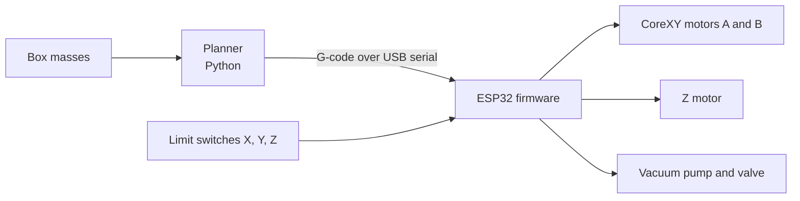

# CoreXY truck loader

A gantry robot built to load boxes into a model truck bed so the load stays balanced. A Python program decides where each box should go, so the center of mass of the whole load ends up in the middle of the bed. Then it sends the moves over USB to an ESP32, which drives a CoreXY gantry, a Z axis and a vacuum gripper.

I built it for the All-Russian School Olympiad (Technology, robotics track). In 2025 I was a prize-winner at the regional stage with it and reached the national final.

Photos of the build and my other robots: https://someone192.github.io

## Why balance the load

When a truck is loaded unevenly, its center of mass shifts to one side or to one end. Some axles carry more weight than they should, and the truck is less stable in turns and when braking. People usually place boxes by feel. I wanted a robot that does the placing and the math at the same time.

## How it works

1. The truck bed is a grid of 5 × 4 cells, 68.75 mm each. The planner puts the heaviest boxes in the cells closest to the center, then swaps boxes at random (simulated annealing) to get the center of mass closer to the middle.
2. It sends `G28` to home the machine, then two `G0 X… Y…` moves per box: one to the pickup zone and one to the box's cell.
3. The firmware turns X/Y into steps for the two CoreXY motors (A = X + Y, B = X − Y), moves, lowers the gripper, switches the vacuum and lifts it back up.

## Hardware

| Part | What it is |
|---|---|
| Frame | Steel square tube, welded, on four legs |
| XY motion | CoreXY belt drive, two stepper motors, 20-tooth pulleys, 5 steps per mm |
| Z motion | Stepper motor |
| Gripper | Suction cup with a vacuum pump and a valve |
| Electronics | ESP32 and three stepper drivers on a prototype board I soldered by hand. I also designed a PCB for it, but the factory sent it a month later than promised, so it isn't in the robot yet |
| Homing | Limit switches on X, Y and Z |

The firmware limits travel to 550 × 500 mm.

## Software

| File | What it does |
|---|---|
| `code.py` | Planner and serial control (Python, needs `pyserial`) |
| `moving_with_g_code.ino` | ESP32 firmware (Arduino, needs the `AccelStepper` library) |

To run it: upload the firmware with the Arduino IDE, then run `python code.py`. The serial port (`COM18`) and the list of box masses are set inside `code.py`. The firmware talks at 115200 baud and waits 15 s after a reset before it accepts commands.

## Who did what

I designed the frame in FreeCAD and welded it, soldered the control board, designed a PCB for it, and wrote the firmware and the planner. My robotics teacher helped me with the code.

## Status

In summer 2026 I had to wipe my laptop and lost the newest firmware and my notes. The code here is an older version from April 2026. The robot is partly taken apart, and I'm putting it back together.

Known problems in this version:

- The planner only works right if the masses are listed from heaviest to lightest. Otherwise boxes go to the wrong cells.
- The last row of the pickup zone is at Y = 515.6 mm, but the firmware stops at 500 mm, so the gripper misses those boxes by about 15 mm.
- Every `G0` command switches the vacuum. If one command gets lost, pick and place swap for every box after it. Gripping should be a separate command.
- In a test of 30 runs, simulated annealing did no better than random swaps with the same number of tries. Both left the center of mass about 0.3 mm off.
- The X/Y limit switches are on GPIO34 and GPIO35. These ESP32 pins have no internal pull-down resistors, so the board has to have its own. I still need to check that mine does.

## Experiments that are not in the robot yet

- [olympiad_project_pybind](https://github.com/someone192/olympiad_project_pybind): the annealing rewritten in C++ and called from Python with pybind11
- [olympiad_project_cv_part](https://github.com/someone192/olympiad_project_cv_part): my first try at training a YOLO model for camera detection, on a test target (not boxes yet)
